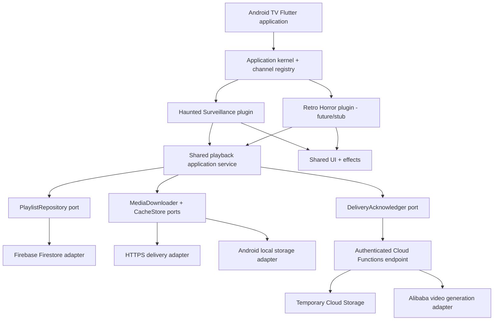

# Halloween TV — Haunted Surveillance

**Technical Design & Implementation Plan (Android TV)**  
**Version:** 1.0 — Architecture baseline  
**Last updated:** October 28, 2026  
**Status:** Decisions recorded; implementation planned  
**Audience:** Project maintainer, future collaborators, reviewers, and coding agents  
**Primary feature:** Live "Haunted Surveillance" CCTV Wall  
**Future channel:** Retro Horror Channel  
**Target platform:** **Android TV only**

---

## 1. Executive summary

**Halloween TV** is a Flutter-based Android TV application designed to create a Halloween-themed, cinematic experience during a gathering of approximately **25 guests**. Its first channel, **Haunted Surveillance**, displays a **2 × 2 wall of fictional security-camera feeds**: eerie rooms, surveillance-style timestamps, camera labels, recording indicators, occasional glitches, and intermittent supernatural events. Over time, a scene can become more unsettling. With permission, future versions may feature AI-generated appearances of party guests in the videos.

A second planned channel, **Retro Horror Channel**, will reuse the underlying player, effects, scheduling, and media-delivery infrastructure to show retro television programming, fabricated horror commercials, corrupted transmissions, and occasional cryptic messages. Other Halloween experiences should be addable without restructuring the Android TV application.

This project has **two simultaneous goals**:

1. **Deliver an entertaining party installation** that can run reliably on a TV and continue playing when the network is interrupted.
2. **Demonstrate software architecture skills** through a package-based Flutter monorepo, explicit module boundaries, extensible channels, reusable media capabilities, and testable ports and adapters—without introducing unnecessary MVP features.

The architectural combination is:

- **Modular monolith** at repository/application level: feature and infrastructure packages developed, tested, and released together.
- **Microkernel/plugin architecture** for Halloween channels: a small application host registers well-defined channel implementations.
- **Hexagonal architecture (ports and adapters)** for application/domain logic and infrastructure independence.
- **Melos + Dart Pub Workspaces** to manage Flutter/Dart packages and quality checks.
- **Firebase** for Firestore, authentication/session management, temporary Cloud Storage, and Cloud Functions or Cloud Run orchestration.
- **Flutter + `video_player`** for Android TV rendering, using locally cached MP4s during playback.
- **Alibaba Cloud Model Studio / Token Plan** for planned video generation, initially considering `wan3.0-video` and three HappyHorse 1.1 variants.
- **FFmpeg** for transcoding, compositing, normalization, and reusable offline effects.

**Important:** The user has selected **Android TV exclusively for this draft**. Do not implement or plan a parallel Tizen, Apple TV, webOS, or LG-specific runtime. Spotify integration, guest QR onboarding, and BYOK are not MVP features, although their later needs influence the boundaries today.

---

## 2. Background, product goals, and design philosophy

### 2.1. Event context

- Event: Halloween party, Saturday, **October 31, 2026**.
- Expected attendance: approximately **25 people**.
- Screen role: primarily **ambient decoration**, with the potential to become a focal point when a paranormal event occurs.
- Interaction level for first release: **non-interactive for guests**; TV remote control is sufficient for app setup, launch, recovery, and a future channel switcher.
- Visual tone: fictional/haunted CCTV, not a real surveillance system.
- Audio: **muted in the MVP**, allowing the party's normal music setup to remain independent.

### 2.2. Product principles

1. **Reliability beats feature count:** a continuous 2 × 2 wall that survives disconnections is more valuable than an unreliable online demonstration.
2. **Minimize video-generation expenses:** start from low-cost, low-resolution generation and reuse/loop completed clips.
3. **Keep the TV lightweight:** video generation and heavy compositing take place outside the TV.
4. **Minimize retained guest media:** use a temporary processing-and-delivery workflow, then purge cloud assets; define an independent cleanup policy for the TV cache.
5. **Prefer local playback:** Firestore is a control/configuration source, not a frame-by-frame media streamer.
6. **Build meaningful abstractions, not speculative frameworks:** introduce a port when it separates an actual dependency or a known future extension.
7. **Show the architecture in code and tests:** package boundaries, domain types, failure handling, and quality gates should demonstrate the design better than diagrams alone.

### 2.3. Success criteria

The MVP is complete when an Android TV device can:

- Install and launch the app in landscape, with a TV-remote-friendly recovery path.
- Render **four independently looping video tiles** in a deterministic 2 × 2 grid.
- Display `CAM-01` through `CAM-04`, a changing wall-clock timestamp, a `REC` indicator, and subtle effects.
- Load a versioned four-clip manifest, retrieve missing video files, validate content hashes, and **switch to the new set only after all required files are ready**.
- Continue displaying a valid previously cached wall if Firestore, the Internet, or the generation backend is temporarily unavailable.
- Accept an authenticated delivery acknowledgment; have the server remove temporary cloud objects after successful delivery, subject to bounded cleanup/failure handling.
- Recover from a corrupt clip, download failure, or unsupported media format without crashing the entire wall.
- Pass unit tests for playback preparation and package dependency constraints.

A practical first showcase may use **four pre-generated MP4 fixtures** before the automated generation backend is wired up. The architecture and application-facing contracts remain the same.

---

## 3. Decisions and scope register

### 3.1. Confirmed decisions

| ID | Decision | Rationale |
|---|---|---|
| D-01 | **Android TV only** | Narrow target, faster delivery and testing |
| D-02 | **Flutter + `video_player`** | Familiar framework and media API |
| D-03 | **Fixed 2 × 2 CCTV wall** | Recognizable aesthetic, bounded decoding workload |
| D-04 | **Firebase Firestore; no Realtime Database** | Single backend control-plane database |
| D-05 | **Firebase Functions/Cloud Run + temporary Cloud Storage** | Video processing, orchestration and delivery |
| D-06 | **Download and locally cache clips** | Reliable playback, short network access windows |
| D-07 | **Cloud media only during processing/delivery, then deleted** | Minimize media retention and hosting burden |
| D-08 | **Modular monolith + microkernel + hexagonal** | Explicit architecture showcase, channels remain extensible |
| D-09 | **Melos monorepo** | Manage shared packages, CI, and boundaries |
| D-10 | **Future Retro Horror Channel** | Reuse shared players/effects/scheduling contracts |
| D-11 | **Future guest QR/join experience** | Consent and uploads later, not MVP |
| D-12 | **Future BYOK** | Possibility of a free, user-funded product later |
| D-13 | **No Spotify integration in MVP** | Avoid remote playback/API complexity |
| D-14 | **Alibaba video models** | Replace the earlier Veo-based animation plan |
| D-15 | **Prioritize cheapest demo model/configuration** | Reduce iteration cost |
| D-16 | **Personal use now; revisit provider licensing later** | Preserve the planned architecture at present |

### 3.2. Explicitly excluded from this implementation

- Spotify authentication, playback, visualization, or music-reactive effects.
- Guest companion website, QR joining, selfie submissions, or consent UI (contracts only).
- Runtime download or installation of arbitrary Flutter/Dart plugins.
- A fully user-configurable BYOK configuration screen or multi-tenant billing.
- Motion-sensor camera triggers, real-time guest camera feeds, or Scare Cam hardware integration.
- Other TV operating systems or platform-specific compatibility layers.
- A permanently hosted video library.

### 3.3. In scope as extension points, not finished features

- Static registration of a `RetroHorrorChannelPlugin` stub.
- `PartyId`, `DeviceId`, owner/session identity, and future `TenantId` concepts.
- A provider-agnostic backend `VideoGenerationPort`.
- A `ChannelPlugin` contract and shared effects/media facilities.
- Manifest versioning so new generated clips can be introduced without interrupting active playback.
- Metadata structures for a future guest cameo and future provenance/consent state.

---

## 4. User experience and behavior

### 4.1. The 2 × 2 CCTV wall

```text
+--------------------------------------+--------------------------------------+
| CAM-01  REC  2026-10-31 21:45:17      | CAM-02  REC  2026-10-31 21:45:17      |
|                                      |                                      |
|       ABANDONED HALLWAY              |          EMPTY KITCHEN               |
|                                      |                                      |
+--------------------------------------+--------------------------------------+
| CAM-03  REC  2026-10-31 21:45:17      | CAM-04  REC  2026-10-31 21:45:17      |
|                                      |                                      |
|          STAIRCASE                   |         STORAGE ROOM                 |
|                                      |                                      |
+--------------------------------------+--------------------------------------+
```

Each tile has its own independent video and visual presentation. The overlay is **drawn locally in Flutter** rather than baked into every MP4. This makes it reusable by future channel plugins and allows camera names, timestamps, and effects to change without a video regeneration request.

**Initial scene set:** hallway, kitchen, staircase, storage room (placeholder labels, editable without architecture changes).

**UI components:**

- 2 × 2 layout with small dark gutters.
- Camera identifier, timestamp, `REC` badge/indicator, optional subtle corner frame.
- Static scanlines, vignette, intermittent noise bursts, rare short signal losses.
- Occasional paranormal events already embedded in clips, or locally triggered overlays.
- A `SIGNAL LOST` visual fallback when a tile is unplayable.
- An app-level loading/recovery status when **no** complete cached wall is available.

### 4.2. Spooky event progression

The original concept calls for the wall to become creepier as the party continues. Implement the **policy** locally even if the first content set is fixed.

Suggested phases, **configurable rather than hard-coded by real-world time**:

| Phase | Relative time in session | Behavior |
|---|---:|---|
| Subtle | 0–30 min | Normal rooms, minimal noise, brief shadows |
| Uneasy | 30–90 min | Slightly more glitches and rare apparitions |
| Haunted | After 90 min | More conspicuous events and selective camera focus |

An `EventPolicy` schedules events with a seeded or injectable random source. Do **not** redraw shaders or rebuild every video controller each second. Event timing and effect state should be separated from video decoding.

**Optional later:** briefly enlarge an individual feed for a 10–20 second event, then return to the 2 × 2 wall. Do not include zoom in the first functional milestone.

### 4.3. Remote control and accessibility

- Default launch: restore last successful channel and playback manifest.
- D-pad/OK: access a minimal hidden settings/recovery overlay.
- Back: close overlay; avoid accidentally exiting the installation.
- Recovery actions: `Retry download`, `Replay cached wall`, `Disable effects`.
- Visible controls are high-contrast and large enough for a TV viewing distance.
- No touch gesture is required. Disable/handle Android screensaver and keep-screen-on only where platform policy and user settings allow.
- Keep video audio muted by default; a future soundscape channel can make audio opt-in.

---

## 5. Architecture overview

### 5.1. Architectural styles and their roles

**Modular monolith:** The Flutter deliverable is one Android application containing multiple independently owned packages. Deployment remains one APK; package separation is for encapsulation, testing, ownership, and reuse—not independent microservices.

**Microkernel / plugin architecture:** A small host provides lifecycle, services, and a channel registry. Each channel is a compile-time Flutter package that implements `ChannelPlugin`. The kernel selects the active channel and provides capabilities. Flutter's tree shaking and AOT compilation mean **plugins are registered at build time**, not dynamically loaded executable code from the network.

**Hexagonal architecture:** Domain/application logic depends on **ports**, e.g. `PlaylistRepository`, `MediaDownloader`, `CacheStore`, `DeliveryAcknowledger`, and `Clock`. Firebase, HTTP downloads, file system, and video rendering remain adapters. The domain is testable without Firestore or Android.

**Separation of concerns:** Not all modules need identical `domain/application/adapters/ui` folders. The media preparation domain deserves full hexagonal separation; a simple UI-only effects widget should not be forced to imitate a complex domain.

### 5.2. Logical architecture



### 5.3. Dependency direction

```text
                  apps/tv_app
                       |
                app_kernel (DI)
                  /    |     \
                 /     |      \
        channel_cctv  channel_retro   infrastructure adapters
              |            |             |
              +------- channel_api ------+
              |            |
              +------ media_domain <-----+
              +------ core_ui/effects
```

Rules:

1. `apps/tv_app` and the composition root know the selected plugins and concrete adapters.
2. `channel_cctv` and `channel_retro` depend on **shared contracts**, not on the Firebase SDK or concrete HTTP cache implementations.
3. `media_domain` contains no Firebase, `dart:io`, UI widgets, or cloud-provider code.
4. Infrastructure adapters implement interfaces owned by the domain/application boundary.
5. No feature channel imports another channel; reusable behavior moves into an appropriate shared module.
6. The plugin registry is **static and explicit**, enabling predictable releases and offline operation.
7. A CI dependency check must fail if a channel gains a forbidden `infra_*` dependency.

---

## 6. Monorepo and package boundaries

### 6.1. Recommended directory tree

The earlier brainstorming listed many small packages. Consolidate where appropriate for the MVP; the following layout balances showcase value with manageable package count:

```text
halloween-tv/
├── pubspec.yaml                     # Pub Workspace + Melos configuration
├── pubspec.lock
├── analysis_options.yaml
├── README.md
├── docs/
│   ├── architecture.md
│   ├── decisions/
│   ├── firestore-schema.md
│   ├── privacy-and-retention.md
│   └── prompts/
├── apps/
│   └── tv_app/                      # Android TV Flutter executable
├── packages/
│   ├── app_kernel/                  # composition root, navigation, lifecycle
│   ├── channel_api/                 # plugin SPI and channel context
│   ├── channel_cctv/                # current complete feature
│   ├── channel_retro/               # future plugin, compile-time stub
│   ├── media_domain/                # playlist, clip, ports, prepare use case
│   ├── media_local_cache/           # durable Android filesystem adapter
│   ├── infra_firestore/            # manifest repository adapter
│   ├── infra_delivery/             # signed-URL download + ack client
│   ├── core_ui/                    # camera HUD, signal-loss, theme
│   ├── core_effects/               # scanlines/glitch effect system
│   └── testing_toolkit/           # fake ports, fixtures, test helpers
├── backend/
│   └── functions/                  # TypeScript Firebase Functions (not a Dart workspace member)
├── scripts/
│   ├── check_boundaries.dart
│   ├── seed_manifest.ts
│   └── transcode.sh
└── .github/workflows/
    └── ci.yml
```

The `channel_retro` package may initially contain a descriptor and a placeholder page, but no duplicate playback logic. Additional independent packages are warranted only when there is a clear owner or reuse boundary.

### 6.2. Current Melos configuration

As of this document, **Melos 8 uses Dart Pub Workspaces** and a root `pubspec.yaml`. The earlier sample using a standalone `melos.yaml` is superseded. Explicit workspace paths avoid assuming a particular Dart SDK's glob support.

```yaml
# pubspec.yaml (root)
name: halloween_tv_workspace
publish_to: none

environment:
  sdk: '>=3.9.0 <4.0.0'

workspace:
  - apps/tv_app
  - packages/app_kernel
  - packages/channel_api
  - packages/channel_cctv
  - packages/channel_retro
  - packages/media_domain
  - packages/media_local_cache
  - packages/infra_firestore
  - packages/infra_delivery
  - packages/core_ui
  - packages/core_effects
  - packages/testing_toolkit

dev_dependencies:
  melos: ^8.10.0

melos:
  scripts:
    check: dart run scripts/check_boundaries.dart
    backend:test: cd backend/functions && npm test
```

Each workspace package declares `resolution: workspace` in its `pubspec.yaml`. The exact Flutter/Dart SDK version should be pinned to an installed toolchain before lockfile creation; the range above is illustrative and must satisfy all selected package constraints. For day-to-day work, prefer built-in `melos analyze`, `melos test`, `melos format`, and `melos bootstrap` rather than recreating them with scripts.

```bash
# from repository root
dart pub get
melos bootstrap
melos analyze
melos test
melos run check

# run from the Flutter executable package
cd apps/tv_app
flutter run -d <android-tv-device-id>
```

For Android TV release builds, run `flutter build apk --release` inside `apps/tv_app`, ensure the manifest advertises TV/Leanback support, and validate D-pad navigation and landscape behavior on a real device. Do not assume a phone-configured APK automatically provides a satisfactory Android TV launcher experience.

---

## 7. Plugin API and application composition

### 7.1. Channel contract

The SPI owns stable identifiers and UI entry construction. Channels may choose their own controllers/state management; the kernel controls installation and selection.

```dart
// package:channel_api
import 'package:flutter/widgets.dart';

abstract interface class ChannelPlugin {
  ChannelDescriptor get descriptor;
  Widget build(ChannelContext context);
}

class ChannelDescriptor {
  final String id;          // e.g. haunted_surveillance
  final String title;
  final String version;
  final Set<ChannelCapability> capabilities;

  const ChannelDescriptor({
    required this.id,
    required this.title,
    required this.version,
    required this.capabilities,
  });
}

enum ChannelCapability { videoPlayback, effects, timedEvents, guestMedia }

class ChannelContext {
  final String partyId;
  final PlaybackCoordinator playback;
  final ChannelSettings settings;

  const ChannelContext({
    required this.partyId,
    required this.playback,
    required this.settings,
  });
}
```

`PlaybackCoordinator` and `ChannelSettings` are shared abstractions defined in domain/application packages. The above illustrates contract shape, not a standalone compiling file; imports are omitted for cross-package types.

**Naming:** The channel ID is stable. Display names can change independently from stored manifests.

### 7.2. Explicit registration

```dart
final channels = <ChannelPlugin>[
  HauntedSurveillancePlugin(),
  // RetroHorrorChannelPlugin(), // register when functional
];
```

The app kernel checks for duplicate IDs, validates declared capabilities, selects the active channel, and supplies its context. The CCTV plugin must be able to boot with a fake coordinator in widget tests.

### 7.3. State management and DI

**Recommendation:** Use constructor injection at domain/package boundaries. Use **Riverpod**, which is already familiar in this project context, only where reactive UI composition and lifecycle management make it useful. Avoid a separate service locator on top of a Riverpod provider graph unless a real requirement emerges.

Division of responsibility:

- App kernel / provider composition: concrete Firebase/HTTP/cache dependencies.
- Playback application service: prepare/activate/ack/cancel lifecycle.
- Channel controller: camera assignments, event timing, overlay state.
- Widgets: presentation and `video_player` controller lifecycle.

---

## 8. Domain model and ports

### 8.1. Manifest/playlist model

A **manifest** describes exactly which verified files make up one playable CCTV wall version. Its identity is not the same as expiring transport URLs.

```dart
class PlaybackManifest {
  final String partyId;
  final String channelId;
  final int version;
  final List<ClipDescriptor> clips; // CCTV validates exactly four
  final OverlaySettings overlay;
  final DateTime publishedAt;
  const PlaybackManifest({
    required this.partyId,
    required this.channelId,
    required this.version,
    required this.clips,
    required this.overlay,
    required this.publishedAt,
  });
}

class ClipDescriptor {
  final String id;
  final String cameraId;
  final String storageObjectId;   // opaque reference, never a secret
  final String sha256;
  final int sizeBytes;
  final Duration duration;
  final String mimeType;
  const ClipDescriptor({
    required this.id,
    required this.cameraId,
    required this.storageObjectId,
    required this.sha256,
    required this.sizeBytes,
    required this.duration,
    required this.mimeType,
  });
}
```

**Validation invariants (CCTV):**

- Four clips; unique `cameraId` in the set `CAM-01` to `CAM-04`.
- Version strictly greater than the active version before activation.
- Supported MP4/H.264 media and known expected length, size, checksum.
- Valid, non-empty party/channel references and bounded numeric effects settings.
- Playback data is immutable after publication; a changed clip set increments the version.

### 8.2. Ports (domain-facing contracts)

```dart
abstract interface class ManifestRepository {
  Stream<PlaybackManifest> watchCurrent({
    required String partyId,
    required String channelId,
  });
}

abstract interface class MediaDownloader {
  Future<DownloadedMedia> downloadAndVerify(ClipDescriptor clip);
}

abstract interface class CacheStore {
  Future<CachedMedia?> findVerified(ClipDescriptor clip);
  Future<void> commit(DownloadedMedia media);
  Future<void> deleteExpired();
}

abstract interface class DeliveryAcknowledger {
  Future<void> acknowledge({
    required String partyId,
    required String channelId,
    required int manifestVersion,
    required List<String> verifiedClipHashes,
  });
}

abstract interface class Clock {
  DateTime now();
}
```

The domain uses data-only `CachedMedia`/`DownloadedMedia` value types (with an opaque local resource identifier); it does **not** need to import `dart:io`. A platform adapter can resolve local paths at the edge where `video_player` is created.

### 8.3. PreparePlayback use case

```text
Input: manifest vN
    |
    v
Validate manifest and camera assignments
    |
    v
For each clip: cached & hash-verified?
    | yes                         | no
    |                             v
    |                         Obtain delivery URL
    |                             |
    |                         Download to temp file
    |                             |
    |                         Check byte count + SHA-256
    |                             |
    |                         Atomic rename to cache
    +-------------+---------------+
                  |
            All four verified?
               /      \
             no        yes
             |          |
       Retain old wall  Write new manifest index atomically
       Retry or fail    | 
                        Activate new wall
                        |
                        Acknowledge receipt
                        |
                 Server purges delivery objects
```

**Important behavior:**

- **Do not destroy the existing four video players while a new manifest is partially downloaded.** Prepare a complete staged version first.
- Limit concurrent downloads to two by default; this prevents download bursts from competing with video decoding and other network traffic.
- Verify hashes before committing and before acknowledging. Download initially to `*.part`, then atomically move/rename.
- Keep **last-known-good** content until the replacement has proven usable.
- Acknowledge only after all four files have been durably stored and validated; optionally perform a lightweight playback compatibility check before ack.
- Offline start should use the local committed manifest index when a remote watch cannot be established.
- Network retry uses capped exponential backoff with jitter; no infinite tight loop.
- Expose explicit states: `booting`, `usingCache`, `preparing`, `ready`, `errorRecoverable`, `errorFatal`.

---

## 9. Firebase design

### 9.1. Product-level Firestore hierarchy

```text
/parties/{partyId}
  ownerUid
  name
  status                 # preparing | live | archived
  activeChannelId        # haunted_surveillance
  layout                 # 2x2
  createdAt
  retentionDeadline

/parties/{partyId}/channels/{channelId}
  theme
  overlaySettings
  eventSettings

/parties/{partyId}/manifests/current_{channelId}
  version
  publishedAt
  cameraClips[4]         # metadata and opaque storageObjectId
  schemaVersion

/parties/{partyId}/jobs/{jobId}
  channelId
  type                   # generate | compose | publish
  state                  # queued | running | ready | delivering | purged | failed | expired
  modelId
  costEstimate
  createdAt, updatedAt, expiresAt
  errorCode              # sanitized

/parties/{partyId}/devices/{deviceId}
  registeredAt
  lastSeenAt
  activeManifestVersion

/parties/{partyId}/deliveryAcks/{ackId}
  deviceId
  channelId
  manifestVersion
  checksums
  acknowledgedAt

# Later, not part of MVP:
/parties/{partyId}/guests/{guestId}
/tenants/{tenantId}
```

**Key design choice:** Store playlist metadata in Firestore and deliver short-lived signed URLs **via a callable/authenticated function at download time**. That avoids writing expiring credentials into a long-lived manifest and allows URL refresh without a new playlist version. A simpler pilot can include signed URLs directly in the manifest if they are genuinely short-lived and access is strictly scoped, but this is not the recommended lasting contract.

### 9.2. Firestore is the control plane

- The Flutter client watches only the active manifest and relevant channel settings.
- Firestore changes are low-frequency; generated clips are not streamed via Firestore.
- No Realtime Database; no WebSockets are required for the MVP.
- An offline cached manifest is valid for local playback even when the corresponding cloud delivery files have already been deleted.

### 9.3. Authentication, authorization, and App Check

Use **Firebase Auth** identities for the TV session or device, with membership/ownership established server-side. For the personal MVP a single private party and authenticated device can be seeded during setup. Later, a pairing flow can link TV device identity to the party owner.

**Do not treat knowledge of `partyId` as authorization.** Firestore rules should authorize a request based on `request.auth.uid` and membership or claims. A server-side join/pairing operation can establish membership. Cloud Functions must make equivalent checks on each delivery/ack/generation operation.

**App Check** is complementary abuse protection. It is enforced through supported Firebase service configuration and validated at callable endpoints as applicable. It is **not** a custom header accessible to Firestore Security Rules through `request.headers`. Validate availability of the chosen Android TV attestation provider on the actual device; use debug configuration only for local development. Avoid hard-enforcing an unsupported provider before testing real-device enrollment.

Illustrative (simplified) rules; adjust the chosen identity scheme before deployment:

```javascript
rules_version = '2';
service cloud.firestore {
  match /databases/{database}/documents {
    function signedIn() {
      return request.auth != null;
    }
    function isPartyOwner(partyId) {
      return signedIn()
        && get(/databases/$(database)/documents/parties/$(partyId)).data.ownerUid
           == request.auth.uid;
    }
    match /parties/{partyId} {
      allow read: if isPartyOwner(partyId);
      allow write: if false;
      match /channels/{channelId} {
        allow read: if isPartyOwner(partyId);
        allow write: if false;
      }
      match /manifests/{manifestId} {
        allow read: if isPartyOwner(partyId);
        allow write: if false;
      }
      match /{other=**} {
        allow read, write: if false;
      }
    }
  }
}
```

This sample is **owner-only**, suitable for a private single-user pilot. A non-owner TV account requires a separately designed `isMember` predicate or custom claims before being permitted to read the party. Functions/Admin SDK write privileged documents and bypass Firestore rules, so their own authorization checks are critical.

### 9.4. Cloud Storage

```text
/ingest/{partyId}/{jobId}/...           # temporary source inputs
/generated/{partyId}/{jobId}/...        # temporary model outputs
/delivery/{partyId}/{manifestVersion}/... # normalized temporary MP4s
```

- Deny unrestricted direct client listing and public reads.
- Media is temporarily accessible through authorized backend delivery or signed URLs scoped to individual objects.
- Avoid placing personal names/guest photo details in object keys or Firestore logs.
- Use lifecycle policies and an application-level sweeper as defense in depth; specify TTL deliberately, not vaguely.

---

## 10. Processing, delivery, and purge lifecycle

### 10.1. Definition of the retention policy

**Process–Deliver–Purge** means raw input and generated media **must not become a permanent cloud collection**. Temporary cloud retention is allowed only while processing, awaiting an authorized download, or recovering from a bounded delivery failure. The files remain on the Android TV for playback until the configured party/retention period ends.

It is **not possible** to delete a cloud output *before* the TV has obtained it, while still supporting remote delivery. Likewise, deletion from the project bucket does not guarantee deletion of all copies maintained internally by a third-party generation provider or storage service; the provider's own retention rules must be reviewed separately.

### 10.2. End-to-end sequence

```mermaid
sequenceDiagram
    participant Admin as Host/admin request
    participant Fn as Firebase Functions
    participant AI as Alibaba video provider
    participant Store as Temporary Cloud Storage
    participant FS as Firestore
    participant TV as Flutter Android TV

    Admin->>Fn: Request generation (authenticated)
    Fn->>FS: Create job (queued/running)
    Fn->>AI: Submit model generation request
    AI-->>Fn: Job ID / completed output reference
    Fn->>Store: Fetch, normalize and stage MP4 files
    Fn->>FS: Publish manifest vN (four clip metadata)
    FS-->>TV: Manifest vN available
    TV->>Fn: Request short-lived delivery URLs
    Fn-->>TV: Authorized per-clip URLs
    TV->>Store: Download staged MP4 files
    TV->>TV: Verify hashes; commit local cache
    TV->>Fn: Acknowledge vN and hashes
    Fn->>FS: Record idempotent ACK
    Fn->>Store: Delete source/generated/delivery for vN
    Fn->>FS: Mark delivery purged
    TV->>TV: Play locally without network
```

### 10.3. Delivery states and idempotence

- `queued -> running -> ready -> delivering -> purged` is the happy path.
- Any intermediate step may become `failed` or `expired` with a sanitized diagnostic reason.
- Generation and publication handlers must use `jobId` as an idempotency key: duplicate Cloud Functions invocations must not generate or publish multiple versions unintentionally.
- Acknowledge requests are idempotent for `(deviceId, channelId, manifestVersion)`.
- For MVP, **one registered TV** is the target for each party. In a future multi-TV setup, purge only after the required device acknowledgments (or expiry), not the first arbitrary ACK.
- An acknowledgment is a **client declaration of successful verified storage**, not cryptographic proof that a user actually viewed the video; trust it only from the authenticated enrolled device.
- Cloud Functions use protected service credentials for generation and Storage; sensitive tokens never reach the Flutter app.

### 10.4. Timeout and cleanup defaults

Proposed **defaults to tune**:

| Data | Normal deletion trigger | Failsafe deadline |
|---|---|---|
| Uploaded generation input | Processing complete and no longer needed | 24 hours from creation |
| Model intermediate image/video | Normalization completed | 24 hours from creation |
| Prepared delivery MP4 | TV ACK for correct manifest | 24 hours from publication |
| Job/error metadata | Short audit/diagnostic retention | 7 days, then purge or minimize |
| Guest input after future opt-in | Immediate postprocessing | Same input TTL or stricter |
| Verified TV cache | End of party or explicit `Clear party media` | Configurable local expiry (recommended within 24 hours after party) |

Why not simply delete all files after one hour? AI generation, network outages, and download failures could exceed that window. Use a **reasonable capped deadline**, explicit failed-delivery state, and last-known-good cache rather than falsely promising that one hour is always safe. The retention policy is about *no permanent asset hosting*, not making delivery fragile.

**Deletion is operationally best effort**: issue deletion, verify object absence, retry failed deletes, and keep observability only for non-sensitive metadata. Use Cloud Storage lifecycle TTL as a fallback if a Function crashes. Use separate batch cleanup for failed/orphaned jobs.

### 10.5. Local storage and privacy

- Cache only in app-private Android storage (not shared public media directories).
- Store a small manifest index containing checksums and paths, not guest-sensitive text.
- Clear temp `*.part` files after failures and on startup.
- Offer a clear cache/party-data reset action in settings.
- Delete cached party assets after the configured end time or on explicit reset; avoid silent indefinite local preservation.
- Future guest selfie uploads require affirmative informed consent and a delete/withdrawal path, including disabling future generation from that image and removing remaining party media where practicable.

---

## 11. Video generation provider and model selection

### 11.1. Provider decision

The earlier discussion considered Gemini Flash, Gemma, Imagen, and Veo. The **latest confirmed change** replaces **Veo as the video-generation engine** with Alibaba Cloud Model Studio video models accessed through the planned **Alibaba Cloud Token Plan**:

- `wan3.0-video`
- `happyhorse-1.1-i2v`
- `happyhorse-1.1-t2v`
- `happyhorse-1.1-r2v`

**Current position on the earlier Google models:** Gemini Flash/Gemma may remain optional for prompt writing or structured story/event metadata; Imagen may remain an optional still-image source if needed. Neither is required for the CCTV playback MVP. Do not accidentally retain Veo as a video-generation dependency in the architecture.

### 11.2. Model routing

| Use case | Model choice | Why |
|---|---|---|
| Lowest-cost motion test from text | **`wan3.0-video`** | Supports 480p and **2-second minimum** output |
| Reanimate an existing eerie room still | `happyhorse-1.1-i2v` | Dedicated first-frame image-to-video generation |
| Generate a brand-new room from a prompt | `happyhorse-1.1-t2v` | Dedicated text-to-video workflow |
| Use guest-reference images for cameo continuity | `happyhorse-1.1-r2v` | Designed for reference-image-to-video |
| Combined text/image/reference workflows | `wan3.0-video` | Flexible all-in-one input support |

The user has asked to **choose the cheapest of the specified models and cheapest supported configuration for demos**. Based on publicly listed *Singapore on-demand* list prices, `wan3.0-video` is cheaper per output second at **480p** than the three HappyHorse variants. It also allows a shorter 2-second clip, whereas the HappyHorse 1.1 models list a 3-second minimum. This makes `wan3.0-video` + 480p + 2s the **provisional cost-first demo preset**. Token Plan actually deducts **Credits**, not directly the quoted on-demand USD rates; verify the realized credit charge in the console before asserting it is the cheapest under a particular subscription or promotion.

### 11.3. Demo generation preset

```yaml
# Logical application preset, not a literal provider JSON request
id: cheap_demo
provider: alibaba_model_studio
model: wan3.0-video
region: singapore
resolution: 480P
duration_seconds: 2
aspect_ratio: '16:9'
audio: false
outputs_per_request: 1
max_concurrent_jobs: 1
max_generation_attempts: 1
allow_automatic_upscale: false
```

**Why 2 seconds?** The minimum duration minimizes billed output for *pipeline testing*, not necessarily the quality of the final party scene. Once download/playback/purge works end to end, deliberately generate selected **5–8-second** or longer clips for believable ambient motion. Repeat the resulting footage locally; **never regenerate it every time the wall loops**.

### 11.4. Pricing reference (illustrative, not Token Plan credit quotes)

Alibaba's publicly listed Singapore **on-demand** base prices at 480p are approximately:

| Model | Listed rate (USD / output second) | Shortest documented clip | Illustrative cost of minimum clip |
|---|---:|---:|---:|
| `wan3.0-video` | $0.05 | 2 s | **$0.10** |
| `happyhorse-1.1-t2v` | $0.07 | 3 s | $0.21 |
| `happyhorse-1.1-i2v` | $0.07 | 3 s | $0.21 |
| `happyhorse-1.1-r2v` | $0.07 | 3 s | $0.21 |

Prices can change or be discounted, and **Wan 3.0 with a reference video can bill input *and* output duration**. The comparison above assumes a text-only generation test (no input video). The Token Plan has separate Credit accounting and may have different effective economics. Create a tiny empirical cost log after the first completed generation:

```text
model_id, preset_id, seconds_out, seconds_in, credits_charged,
provider_task_id, created_at, success
```

Example budget discipline: four separate **2-second** `wan3.0-video` scenes at the listed Singapore base rate imply **$0.40** of notional on-demand output cost, excluding infrastructure, promotions, taxes, Token Plan accounting and retries. Do not present that as a Token Plan invoice.

### 11.5. Backend generation port

```typescript
export interface VideoGenerationPort {
  submit(request: GenerationRequest): Promise<GenerationJob>;
  getStatus(externalJobId: string): Promise<GenerationStatus>;
  getResult(externalJobId: string): Promise<TemporaryMediaReference>;
}

export type GenerationRequest = {
  jobId: string;              // internal idempotency key
  partyId: string;
  modelId: 'wan3.0-video'
    | 'happyhorse-1.1-i2v'
    | 'happyhorse-1.1-t2v'
    | 'happyhorse-1.1-r2v';
  prompt: string;
  resolution: '480P' | '720P' | '1080P';
  durationSeconds: number;
  audio: boolean;
  inputMedia?: Array<{ kind: 'image' | 'video'; storageRef: string }>;
};
```

The provider adapter maps this application request into the current **model-specific video-generation API** and async polling/task result format. It must support task timeouts, transient failures, and input validation. Never put subscription/API credentials in Flutter. Because input formats and duration constraints vary by model, validate per adapter rather than treating all provider models as interchangeable at the HTTP level.

### 11.6. Provider terms: deferred decision

This is a **personal-use prototype**. Per the latest decision, **retain the planned automated Firebase-to-Alibaba generation design**. Review Token Plan licensing/allowed integrations before external distribution or a paid/free multi-user release. Do not redesign the MVP around licensing uncertainty right now; also do not interpret personal use alone as an established exemption from provider terms.

---

## 12. Generation, composition, and media preparation

### 12.1. Asset creation pipeline

1. Generate or supply a **base scene**: eerie room, hallway, kitchen, staircase, etc.
2. For generation-backed clips, submit a `GenerationRequest` to the selected model.
3. Poll for completion and retrieve its temporary output promptly.
4. Normalize media through FFmpeg: codec, resolution, frame rate, orientation, pixel format, muted audio.
5. Optionally composite glitches, shadows, ghost cameos, or room layers outside the TV.
6. Compute SHA-256 and byte size for each final output.
7. Stage the files in temporary delivery storage; publish an immutable four-clip manifest.
8. Deliver the files to the TV, obtain ACK, and purge cloud media.

### 12.2. Video format recommendation

- Container: **MP4**.
- Codec: **H.264** with a broadly supported Android TV profile (baseline/main selected after device testing).
- Pixel format: `yuv420p`.
- Target frame rate: 24 fps for normalized footage, unless the target hardware favors another supported frame rate.
- Target per-tile playback: **540p at 24 fps** initially; try 720p only after benchmarking four concurrent decoders.
- Aspect ratio: 16:9.
- Audio: removed or muted for MVP.
- Files: target a compact bitrate and bounded file size (e.g. roughly 1–2 Mbps per 540p tile depending on footage; tune from visual results rather than making an arbitrary 20 MB rule).

**Generation vs playback resolutions are different decisions.** The 480p cheap-demo source can be resized to a 540p test asset, but rescaling does not magically create detail. Its degraded aesthetic is acceptable for simulated CCTV. A polished four-screen set may justify generating higher quality source clips later.

### 12.3. Example FFmpeg normalization command

```bash
ffmpeg -i input.mp4 \
  -an \
  -vf "scale=960:540:flags=lanczos,fps=24,format=yuv420p" \
  -c:v libx264 -preset fast -crf 24 \
  -movflags +faststart \
  -y output_camera.mp4
```

For seamless loops, inspect the transition between first and last frame. Simply looping an arbitrary 2-second generated clip is visibly repetitive; an **event burst** may loop acceptably, while ambient footage generally needs longer source clips, a crossfade/pre-rendered loop, or alternating clips. A finalized montage can be regenerated **offline**, not every time it plays.

### 12.4. Prompt templates

**Text-to-video (cheap demonstration):**

> Fixed security-camera view of a deserted, dimly lit service hallway at night. Low-contrast monochrome footage, subtle analog noise, one weak overhead light flickering, no camera movement, no visible text, no watermark, no subtitles. Realistic abandoned-building atmosphere. Very slight motion only. Wide 16:9 composition.

**Guest appearance (future, consent required):**

> Fixed surveillance camera in an empty room at night. A ghostly translucent human figure based on the supplied reference quietly becomes visible near the doorway for a moment, then fades into darkness. Keep the original room composition stable and camera locked. Fictional, non-graphic Halloween horror; no readable text or logos.

**Design advice:** Add `CAM`, `REC`, timestamp, CRT lines, and the final glitch effects **in Flutter or deterministic offline compositing**, rather than asking a video model to render precise changing text.

---

## 13. Flutter rendering and effects

### 13.1. Widget composition

```text
CctvChannelEntry
 └─ CctvWall (fixed 2 × 2)
     ├─ CameraTile (CAM-01)
     │   ├─ VideoSurface (video_player)
     │   ├─ EffectLayer (scanlines, vignette, noise)
     │   ├─ CameraHud (label, REC, timestamp)
     │   └─ SignalLostOverlay
     ├─ CameraTile (CAM-02)
     ├─ CameraTile (CAM-03)
     └─ CameraTile (CAM-04)
```

`CameraTile` owns its own `VideoPlayerController` lifecycle, initialize/play/loop/dispose, and error reporting. A manifest switch should update controllers without producing an all-black wall. If the device struggles with four hardware decoder sessions, fall back to a **single precomposed 2 × 2 MP4** produced by FFmpeg; that fallback changes a rendering adapter, not the manifest/domain contract (the playback representation may be adapted in the render layer).

### 13.2. Shared effects library

`core_effects` should expose reusable effects as lightweight, composable **profiles**:

```dart
enum EffectType { scanlines, vignette, noise, rgbSplit, signalLoss }

class EffectSpec {
  final EffectType type;
  final double intensity; // validated, 0.0 to 1.0
  const EffectSpec(this.type, this.intensity);
}

class EffectProfile {
  final List<EffectSpec> effects;
  const EffectProfile(this.effects);
}
```

**CCTV preset:** mild scanlines, light vignette, infrequent noise/signal failures.  
**Retro preset:** stronger scanlines, color bleed, analog distortion, old television transitions.

Prefer cheap cached overlays/CustomPaint for the first iteration. Fragment shaders are an optional optimization/polish step, not an automatic win. Test actual Android TV GPU behavior, avoid a full-screen high-cost image effect over four video surfaces unless profiling validates it, and account for platform composition behavior.

### 13.3. Deterministic testing

- Inject a `Clock` and `Random`/event source for event policies.
- Allow effects to be disabled in widget/golden tests.
- Use a fake `VideoSurface` widget or adapter when the test environment lacks hardware video decoding.
- Validate responsive 16:9 layouts and padding independently of real MP4 playback.

---

## 14. Backend functions and operational contracts

### 14.1. Functions / services

| Endpoint/service | Trigger | Responsibility |
|---|---|---|
| `requestGeneration` | Authenticated admin callable | Validate configuration, set budget guardrails, create generation job |
| `runGeneration` | Worker / task queue | Submit, poll, collect model outputs; idempotent job handling |
| `normalizeAndStage` | Internal workflow | FFmpeg normalization, SHA-256, temporary Storage paths |
| `publishManifest` | Internal workflow | Atomically write current version after all four outputs ready |
| `getDeliveryUrls` | Authenticated TV callable | Authorize TV, generate limited-time per-object URLs |
| `acknowledgeDelivery` | Authenticated TV callable | Validate party/device/version/checksums, record ACK and purge |
| `sweepExpiredMedia` | Scheduled job | Remove orphans/expired assets and mark unrecoverable delivery |
| `clearPartyData` | Authenticated owner action (later) | Remove party metadata/assets per policy |

### 14.2. Example API payloads

**Generation request (internal/admin-facing):**

```json
{
  "partyId": "party_opaque_01",
  "channelId": "haunted_surveillance",
  "preset": "cheap_demo",
  "sceneId": "hallway",
  "prompt": "Fixed security-camera view of a deserted hallway...",
  "idempotencyKey": "scene-hallway-attempt-01"
}
```

**Delivery request:**

```json
{
  "partyId": "party_opaque_01",
  "channelId": "haunted_surveillance",
  "manifestVersion": 4,
  "clipIds": ["cam01-v4", "cam02-v4", "cam03-v4", "cam04-v4"]
}
```

**Delivery ACK:**

```json
{
  "partyId": "party_opaque_01",
  "channelId": "haunted_surveillance",
  "deviceId": "device_opaque_01",
  "manifestVersion": 4,
  "verifiedClipHashes": ["sha256-1", "sha256-2", "sha256-3", "sha256-4"]
}
```

Payloads are illustrative, **not executable endpoint specifications**. The server must derive trusted identity from the verified authentication context; it must not trust caller-supplied `deviceId`, `partyId`, or hashes without checking registration, requested manifest, and canonical stored hashes. For production, define a versioned shared contract and use explicit error codes: `UNAUTHENTICATED`, `FORBIDDEN`, `MANIFEST_MISMATCH`, `CLIP_EXPIRED`, `PROVIDER_UNAVAILABLE`, `BUDGET_EXCEEDED`.

### 14.3. Budget guards

- Default demo maximum **one generation request in flight**.
- Default **zero automatic retries** for billable AI requests until failure semantics are known; retry only proven non-billable transient submission errors.
- Require explicit action to generate new content; no schedule that silently generates clips all night.
- Log usage/cost metadata and model ID, not raw face imagery or sensitive prompts.
- Future BYOK usage limits must be enforced **per tenant**, not just in UI.

---

## 15. Future extensions and why the boundaries exist today

### 15.1. Retro Horror Channel

Planned second plugin:

- Retro analog-TV broadcast screen, static, simulated station IDs, 1980s-style horror segments.
- Short fake horror commercials; some later contain transformed images of consenting guests.
- Rare cryptic text transmission or picture distortion.
- Shared media preparation, manifest delivery, cache, timing abstractions, effects and HUD primitives.
- Channel-specific layout and scheduling logic stay inside `channel_retro`.

**Reuse target:** common player, temporary delivery, cache, manifest, shaders/effects and error handling. The previous conversation mentioned an 80% reuse aspiration; treat that as a qualitative design goal, **not a measured engineering result**.

### 15.2. Companion QR page

Future flow:

1. Display a short-lived QR/party join code on the TV or admin screen.
2. Guest opens a mobile-friendly page via Firebase Hosting.
3. Guest sees the purpose, visibility, retention, and consent controls.
4. Guest optionally uploads a selfie and chooses a ghost style.
5. Backend assigns that input to the correct party/job, checks consent status, generates a clip, updates the next manifest.
6. Raw guest photo and intermediate results are deleted after processing and successful delivery, respecting bounded TTLs.

**Architecture seams now:** `partyId`, scoped permissions, a `GuestMediaSubmission` DTO reserved for later, provider-agnostic generation request, and per-party jobs. No guest website implementation needed for the MVP.

### 15.3. BYOK (Bring Your Own Keys)

Goal: enable a future free-to-download offering whose users supply their own eligible provider access rather than expecting the application publisher to pay generation bills.

Recommended future design:

- `TenantId` + party ownership introduced now in domain vocabulary, but only one tenant is necessary for personal use.
- Admin setup performs a secure server-side key connection; keys are **never embedded in the Android APK, manifest, or Firestore public documents**.
- Store credentials in an appropriate secret-management service with strict access controls, key rotation and deletion flow.
- Backend `GenerationProviderResolver` selects provider adapter and credentials using the authenticated tenant, not an untrusted party field.
- Quotas, billing/rate limits, audit records, and provider-terms review become release requirements when BYOK goes public.
- TV manifest, local cache, and playback remain unchanged, even when the generation provider is replaced.

**Security caveat:** A multi-tenant BYOK product is a material security and operating expansion. The extension points can be prepared now, but it should receive a separate threat model and architecture review before launch.

### 15.4. Other previously considered Halloween concepts

| Idea | Status | Potential reuse |
|---|---|---|
| AI Fortune Teller | Later/idea | Guest join/prompt generation, presentation plugins |
| Scare Cam | Later/idea | Media rendering, camera capture adapter, effects |
| Motion-Triggered TV | Later/idea | Event engine, external sensing adapter |
| Fake live ghost detector | Later/quick win | Event scheduler, HUD and effects |
| Music visualizer | Deferred | Future audio adapter, effects; Spotify excluded now |
| Costume voting/trivia/group games | Previously brainstormed, not committed | Separate interactive channel + mobile companion |

These are **ideas**, not scope commitments or deliverables for the first release.

---

## 16. Testing and quality strategy

### 16.1. Unit tests

**Media domain:**

- Valid manifest contains exactly four cameras for CCTV.
- Duplicate/missing camera IDs are rejected.
- Manifest versioning and stale-update suppression.
- Verified cache hit skips HTTP download.
- Corrupt checksum triggers quarantine/re-download.
- Partial download cannot replace last-known-good wall.
- ACK occurs only after all four verified files are persisted.
- Clock/event progression and intensity bounds.

**Adapters:**

- Firestore document-to-domain mapping with versioned fixture JSON.
- HTTP 401/403/404/429/5xx handling, signed-URL refresh, backoff.
- Atomic file commit and cleanup of abandoned `.part` files.
- Idempotent ACK and server purge on duplicate requests.
- Provider request mapping, minimum duration checks, budget guards, async terminal states.

### 16.2. Widget/golden tests

- Fixed 2 × 2 wall at multiple TV sizes (using fake video surface).
- HUD label, timestamp placement, error overlay.
- Remote focus and hidden recovery settings overlay.
- Effects enabled/disabled snapshots with deterministic clock/random seeds.

### 16.3. Integration tests

- Local seed manifest + downloadable media fixture from emulator/test HTTP host.
- Network drop during manifest download; previous wall remains visible.
- App killed/restarted with fully cached wall; no network needed to play.
- Server deletion after authorized ACK; confirm all staged objects absent.
- Missing/expired URL refresh and correct failure mode if file has already been purged.
- Cloud Functions duplicate/retry behavior on a test party.

### 16.4. Performance and Android TV validation

On a **real target Android TV device**, measure:

- Four concurrent H.264 hardware-decoder sessions.
- Playback continuity, dropped frames, CPU/GPU utilization, memory pressure.
- Media cache disk use and app cold-start/restart behavior.
- Long-run stability during a simulated multi-hour party.
- Responsiveness of the D-pad recovery menu.
- Decoder/controller disposal when a clip or manifest changes.

Initial working media target: four 540p/24 fps clips. If four simultaneous decoders are unsupported or unreliable, produce **one precomposed CCTV-wall MP4** and keep separate metadata for the four virtual cameras; retain the clean architecture and product look instead of forcing an incompatible player implementation.

### 16.5. CI and architecture checks

Minimum CI:

1. `dart format` / `melos format` verification.
2. `melos analyze`.
3. `melos test` (unit/widget).
4. `melos run check` for package import/dependency boundaries.
5. Backend TypeScript typecheck and tests.
6. Build/compile Android APK and upload test artifacts as appropriate.

Add performance regressions and image/golden snapshots after the first working app. Avoid hard-coded file sizes or frame-rate promises without profiling the specific device.

---

## 17. Implementation roadmap and deliverables

Given the October 31 party, distinguish an **event-ready slice** from the complete architecture showcase. A codebase can be architecturally strong without implementing every future product feature before the event.

### Phase 0 — Bootstrap and contracts

**Deliverables:**

- New Git repo / Flutter Android TV executable.
- Melos 8 Pub Workspace with root configuration, dependency rules, shared analyzer options.
- `channel_api`, `media_domain`, app kernel skeleton.
- Stub/in-memory manifest adapter and four local fixture videos.
- README documenting supported Android TV hardware/runtime assumptions.

**Exit:** `melos analyze`, tests, and Android TV app boot pass.

### Phase 1 — Working CCTV wall (event-ready core)

**Deliverables:**

- Four `video_player` controllers with 2 × 2 layout.
- Local looping video fixtures, muted audio.
- HUD timestamps and camera IDs; scanlines/vignette; basic glitch events.
- Graceful single-tile signal-lost handling and remote recovery overlay.

**Exit:** run continuously from local assets on the actual TV for a representative session with no crash.

### Phase 2 — Manifest and offline-first synchronization

**Deliverables:**

- Firestore adapter, versioned manifest model, robust staging/activation.
- Authenticated TV identity/party access.
- HTTPS/signed-URL download, SHA-256 validation, atomic local cache index.
- Offline restore, refresh and failure handling.

**Exit:** update a manifest, see a complete non-disruptive transition, unplug network and retain playback.

### Phase 3 — Automated processing and purge

**Deliverables:**

- Firebase generation job orchestration and Alibaba provider adapter.
- `cheap_demo` preset (`wan3.0-video`, 480p, 2s, no audio).
- FFmpeg normalizer, temporary cloud delivery files.
- Authenticated ACK, idempotent purge, orphan sweeper.
- Budget/usage log and error statuses.

**Exit:** request test scene -> publish four-clip manifest -> TV downloads -> cloud delivery is deleted -> playback continues.

### Phase 4 — Showcase polish

**Deliverables:**

- Better-quality ambient scenes beyond 2-second test clips.
- Staged subtle-to-haunted event progression, improved effects and transitions.
- Test coverage, architecture diagrams, ADRs, README demos and screenshots.
- Retro Horror plugin shell with proven reuse at package level.

**Exit:** demo feels intentionally designed and repository communicates architectural decisions to reviewers.

### Phase 5 — After the event

- Retro Horror Channel content + fake commercials.
- Companion QR/join page and consented guest cameos.
- BYOK tenant onboarding and secret management.
- Other plugin concepts only if product direction justifies them.

### 17.1. Minimal backlog (implementation order)

| Priority | Task | Package/service | Completion evidence |
|---|---|---|---|
| P0 | Set up workspace and Android TV runner | `tv_app`, root | TV boots; CI analyzes |
| P0 | Define manifest and ports | `media_domain` | Unit tests pass |
| P0 | Static plugin registry | `app_kernel`, `channel_api` | CCTV mounts via host |
| P0 | 2 × 2 local video wall | `channel_cctv` | Four tiles loop stably |
| P0 | Camera HUD and mild effects | `core_ui`, `core_effects` | Golden/widget tests |
| P1 | Cache and prefetch | `media_local_cache`, `infra_delivery` | Offline start works |
| P1 | Firestore manifest adapter | `infra_firestore` | Remote vN loads |
| P1 | Auth + delivery URL endpoint | backend | Scoped download only |
| P1 | ACK + purge + sweeper | backend | Storage empty after ACK |
| P1 | Alibaba cheap-demo generator | backend | One completed 480p/2s job |
| P1 | FFmpeg normalization pipeline | backend/scripts | H.264 MP4 works on TV |
| P2 | Event intensity progression | `channel_cctv` | Deterministic tests |
| P2 | Retro plugin scaffold | `channel_retro` | No copied infrastructure |
| P2 | Architecture ADRs and perf report | `docs` | Reviewer-ready repo |

---

## 18. Risks, trade-offs, and mitigations

| Risk | Impact | Mitigation |
|---|---|---|
| Four concurrent `video_player` instances exceed decoder limits | Black tiles, dropped frames, crash | Profile on target TV; use lower bitrate/resolution; fallback to one precomposed wall |
| 2-second AI demo loops look unnatural | Weak ambient visual quality | Use minimum duration for dev tests only; create longer polished footage for party |
| Expired signed URLs during download | Failed delivery | Request fresh URLs at download time; bounded retry |
| Generation task completes but caller times out | Orphan objects, duplicate bills | Durable job record, idempotency, async worker and sweeper |
| Manifest publishes incomplete set | Inconsistent wall | Atomic publication only after validation of all four clips |
| Purge occurs before TV file is committed | Data loss | ACK only after hash verification and atomic cache commit |
| TV goes offline before receiving new files | Stale wall | Last-known-good local manifest; explicit update retry |
| Provider API limitations/pricing change | Broken or expensive generation | Provider port, configurable presets, credits/cost ledger, no auto-regeneration loop |
| Firestore authorization too broad | Disclosure of private party media metadata | Authenticated device membership, least privilege, server-side checks |
| Process–deliver–purge misunderstood as zero retention | Privacy gap | Clearly separate cloud, provider, and local-device retention |
| Architecture package explosion | Slow delivery/maintenance | Small initial packages, package split only with a real boundary |
| Open/redistributed BYOK introduces misuse/cost risk | Abuse and credential exposure | Separate release review, strong tenant isolation, budgets, secret rotation |

---

## 19. Architecture decision records (ADRs)

These brief ADRs should become separate `docs/decisions/NNNN-*.md` files if the project grows.

**ADR-001 — Android TV only.** Target one runtime to contain risk. Revisit other platforms only after a stable Android release.

**ADR-002 — Flutter media playback via `video_player`.** Standard Flutter video controller lifecycle; hardware capabilities will be tested, with a composite-video fallback.

**ADR-003 — Fixed 2 × 2 wall.** Exactly four logical cameras per CCTV manifest, even if playback renderer changes.

**ADR-004 — Modular monolith / Melos.** One release and repository; multiple Dart/Flutter packages with explicit imports and tests.

**ADR-005 — Microkernel for channels.** Static compile-time plugin registration. Features do not import one another.

**ADR-006 — Hexagonal domain boundaries.** Domain knows playback manifests/cache interfaces, not Firebase/HTTP/Android.

**ADR-007 — Firestore control plane.** No RTDB or live video stream. Low-frequency manifest and settings updates only.

**ADR-008 — Offline-first verified local playback.** Prefetch, hash verification, atomic activation and last-known-good fallback.

**ADR-009 — Cloud media is temporary.** Inputs/outputs/delivery staged with clear deadlines and purged after ACK or expiry.

**ADR-010 — Alibaba generation models.** Use Model Studio; preserve four specified model choices behind a provider adapter. Veo no longer selected for video.

**ADR-011 — Cost-first demo preset.** `wan3.0-video`, 480p, 2 s, no audio, one output; audit Token Plan Credit cost after first run.

**ADR-012 — Future QR, Retro, BYOK without MVP implementation.** Preserve seams while avoiding early feature proliferation.

**ADR-013 — Licensing review deferred for personal use.** Keep technical integration plan; revisit authorized usage before wider distribution.

---

## 20. Open questions / validations (not blockers for MVP scaffolding)

These are deliberately tracked rather than silently assumed:

1. **Hardware performance:** Can the actual Android TV sustain four concurrent H.264 controllers? If not, use the precomposed-wall renderer.
2. **Authentication bootstrap:** For the first personal event, which authenticated owner/device-pairing strategy requires the least fragile setup?
3. **Cloud retention limits:** Are 24-hour input/delivery deadlines suitable for the final use case and guest consent?
4. **Model economics:** What Credit deduction does the actual Token Plan show for one 480p/2s Wan 3.0 job, and is it still the cheapest after plan-specific coefficients or promotions?
5. **Media composition:** Are guest apparitions better produced as fully rendered clips, or as transparent overlays composited before delivery?
6. **Budget controls:** What maximum Credit use should a single party be permitted to consume once automation is active?
7. **Product status:** Before public launch, review token-plan terms, privacy language, third-party model retention and BYOK security requirements.

These do not warrant expanding the Android TV runtime or adding Spotify/companion functionality now.

---

## 21. References and implementation documentation

The following primary documentation informed corrections to the earlier conversation and can be consulted when implementing:

- [Melos package and migration to 8.x / Pub Workspaces](https://pub.dev/packages/melos)
- [Melos Getting Started](https://melos.invertase.dev/getting-started)
- [Flutter video_player package](https://pub.dev/packages/video_player)
- [Firebase App Check — Cloud Firestore](https://firebase.google.com/docs/app-check/cloud-firestore)
- [Firebase Security Rules for Cloud Firestore](https://firebase.google.com/docs/firestore/security/get-started)
- [Firebase Cloud Functions](https://firebase.google.com/docs/functions)
- [Alibaba Cloud Model Studio — Video generation models](https://www.alibabacloud.com/help/en/model-studio/video-generate-edit-model)
- [Alibaba Cloud Model Studio — Wan 3.0 model information](https://www.alibabacloud.com/help/en/model-studio/wan3-0-video)
- [Alibaba Cloud Model Studio — Pricing](https://www.alibabacloud.com/help/en/model-studio/model-pricing)
- [Alibaba Cloud Token Plan overview](https://www.alibabacloud.com/help/en/model-studio/token-plan-overview)
- [Alibaba Token Plan personal quick start](https://www.alibabacloud.com/help/en/model-studio/token-plan-personal-quick-start)
- [Wan 3.0 video generation guide](https://docs.modelstudio.console.alibabacloud.com/en/model-studio/wan3-video-generation-guide)

**Documentation note:** Prices, package versions, and provider API parameters are **time-sensitive as of October 28, 2026**. Recheck official docs and subscription console at implementation time. Code snippets express intended contracts and architecture; they are not an already compiled/deployed product.

---

## 22. Final implementation recommendation

Build **the local 2 × 2 Android TV wall first**, while using the final package boundaries from day one. Then connect the manifest and verified cache, and only afterward integrate automated Alibaba generation and cloud purge. This sequence proves that the core party experience works independently of cloud behavior, retains the architecture showcase value, and minimizes the chance of spending generation Credits debugging a video player or Firestore setup.

The next concrete development artifact should be a **Melos workspace scaffold plus a runnable CCTV channel using four bundled MP4 fixtures**, with `media_domain` ports and a fake manifest adapter. All later backend, privacy, and plugin work can then attach to tested boundaries rather than changing the feature's foundation.
